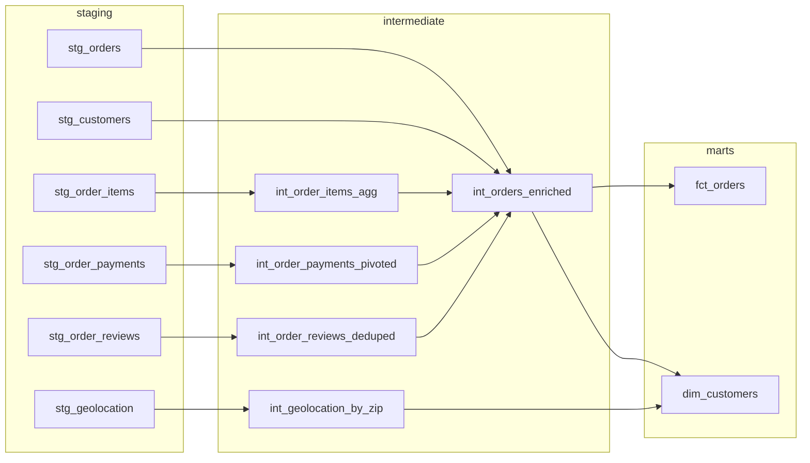

# Olist E-Commerce Analytics with dbt Core and DuckDB

An end-to-end analytics engineering project built with **dbt Core** and **DuckDB** on the public Olist Brazilian e-commerce dataset (about 100k orders across 9 related tables). It turns raw CSV exports into tested, documented, analytics-ready models: staging, intermediate and mart layers, with an incremental fact table.

This is the capstone of a 4-week dbt learning journey. Every modeling decision below is based on exploring the raw data first, and the data quirks I found are documented in [Data quirks and decisions](#data-quirks-and-decisions).

## Business questions
1. Which product categories drive the most revenue? *(Phase 3)*
2. How does late delivery affect review scores?
3. What share of customers are repeat buyers?
4. Which states and sellers have the worst delivery performance? *(Phase 3)*

## Tech stack
- Python 3.11
- dbt-core 1.12 with the dbt-duckdb adapter
- DuckDB (file-based warehouse, no server or cloud account needed)
- dbt packages: `dbt_utils`

## Project status

| Phase | Scope | Status |
|---|---|---|
| 1 | Repo setup, raw load, sources, 9 staging models | Done |
| 2 | Intermediate models, `fct_orders` (incremental), `dim_customers`, tests | Done |
| 3 | `dim_products`, `dim_sellers`, `fct_order_items`, business marts, snapshot, docs | Upcoming |
| 4 | CI with GitHub Actions, dev vs prod, optional cloud warehouse | Upcoming |

---

## Dataset

**Brazilian E-Commerce Public Dataset by Olist** on Kaggle (free account required). Check the license on the dataset page before reusing or redistributing anything derived from it.

The raw CSVs are large and are **not committed** to this repo. To reproduce the project:

1. Download the dataset from Kaggle and unzip it.
2. Place the 9 files in `olist_analytics/data/raw/`:

```
olist_customers_dataset.csv
olist_geolocation_dataset.csv
olist_order_items_dataset.csv
olist_order_payments_dataset.csv
olist_order_reviews_dataset.csv
olist_orders_dataset.csv
olist_products_dataset.csv
olist_sellers_dataset.csv
product_category_name_translation.csv
```

---

## Architecture



`stg_products`, `stg_sellers` and `stg_product_category_translation` are built in Phase 1 and used by the Phase 3 models.

| Layer | Materialization | Purpose |
|---|---|---|
| `raw` (schema) | tables | CSVs loaded exactly as received, every column as text |
| `staging` | views | One model per source table: rename, cast, light cleaning, no joins |
| `intermediate` | views | Deduplication, aggregation and pivoting so every table has one row per key |
| `marts` | tables | Business-ready facts and dimensions |

---

## Repo structure

```
dbt-olist-analytics/
├── README.md
├── .gitignore
└── olist_analytics/                     # the dbt project (run dbt from here)
    ├── dbt_project.yml
    ├── packages.yml
    ├── requirements.txt
    ├── data/
    │   └── raw/                         # 9 Olist CSVs (not committed)
    ├── scripts/
    │   ├── load_raw.py                  # loads CSVs into DuckDB raw schema
    │   ├── explore.py                   # data profiling (phase 1)
    │   ├── explore2.py                  # deeper profiling (phase 2 decisions)
    │   ├── check_phase2.py              # verifies row counts and a first insight
    │   └── incremental_demo.py          # simulates new data for the incremental model
    ├── macros/
    │   └── days_between.sql
    ├── models/
    │   ├── staging/
    │   │   ├── sources.yml
    │   │   ├── schema.yml
    │   │   └── stg_*.sql                # 9 models
    │   ├── intermediate/
    │   │   ├── schema.yml
    │   │   ├── int_order_items_agg.sql
    │   │   ├── int_order_payments_pivoted.sql
    │   │   ├── int_order_reviews_deduped.sql
    │   │   ├── int_geolocation_by_zip.sql
    │   │   └── int_orders_enriched.sql
    │   └── marts/
    │       ├── schema.yml
    │       ├── fct_orders.sql
    │       └── dim_customers.sql
    ├── seeds/
    ├── snapshots/
    └── tests/
        ├── assert_delivered_not_before_purchase.sql
        ├── assert_delivered_orders_have_delivery_date.sql
        └── assert_enriched_row_count_matches_orders.sql
```

Not committed (see `.gitignore`): `target/`, `logs/`, `dbt_packages/`, `*.duckdb`, `venv/`, `profiles.yml`, `data/raw/`.

---

## Setup

### 1. Clone and create a virtual environment

```bash
git clone <your-repo-url>
cd dbt-olist-analytics/olist_analytics

python -m venv venv

# Windows
venv\Scripts\activate
# Mac/Linux
source venv/bin/activate
```

### 2. Install dependencies

```bash
pip install -r requirements.txt
dbt --version
```

`requirements.txt`:
```
dbt-core
dbt-duckdb
```

### 3. Add the dbt profile (not committed)

Add this block to `~/.dbt/profiles.yml` (Windows: `C:\Users\<you>\.dbt\profiles.yml`). Keep any existing profiles in the file.

```yaml
olist_analytics:
  target: dev
  outputs:
    dev:
      type: duckdb
      path: dev.duckdb
      threads: 4
    prod:
      type: duckdb
      path: prod.duckdb
      threads: 8
```

### 4. Load the raw data and build

Run everything from the `olist_analytics/` folder, so `path: dev.duckdb` points at the same database file the load script writes to.

```bash
python scripts/load_raw.py       # raw CSVs -> dev.duckdb (schema: raw)
dbt deps                         # install dbt_utils
dbt debug                        # expect "All checks passed"
dbt build                        # run + test everything in DAG order
```

> DuckDB allows only one writer at a time. Close any script or shell that has `dev.duckdb` open before running dbt.

---

## Phase 1: Setup, raw data, sources and staging

### Raw loading
`scripts/load_raw.py` loads each CSV into the `raw` schema with `all_varchar = true`. Raw data is kept exactly as received, with no type guessing. This matters here because zip code prefixes such as `01046` would lose their leading zero if DuckDB guessed an integer. Types are applied in the staging layer.

```python
con.execute(
    "CREATE OR REPLACE TABLE raw.orders AS "
    "SELECT * FROM read_csv(?, header = true, all_varchar = true)",
    [str(csv_path)],
)
```

The script builds paths from `__file__`, so it works from any working directory, and it accepts an optional database path for loading into `prod.duckdb`:

```bash
python scripts/load_raw.py prod.duckdb
```

### Sources
All 9 raw tables are declared in `models/staging/sources.yml` and referenced with `source('olist', '<table>')`. Primary-key tests (`unique`, `not_null`) run on customers, orders, products and sellers. Freshness checks are deliberately omitted: this is a static dataset with no load timestamp, so a freshness rule would be meaningless.

### Staging models

One model per source table, with renames, type casts and light cleaning only.

| Model | Grain | Notes |
|---|---|---|
| `stg_customers` | one row per `customer_id` | City lowercased, state uppercased |
| `stg_orders` | one row per order | All timestamps cast to `timestamp` |
| `stg_order_items` | one row per order item | `price` and `freight_value` cast to `decimal(10,2)` |
| `stg_order_payments` | one row per payment | An order can have several |
| `stg_order_reviews` | one row per review | `review_id` is not unique (see quirks) |
| `stg_products` | one row per product | Fixes the `lenght` typo in the raw column names |
| `stg_sellers` | one row per seller | |
| `stg_geolocation` | one row per coordinate point | About 52 points per zip prefix |
| `stg_product_category_translation` | one row per category | Portuguese to English names |

### Exploration
`scripts/explore.py` and `scripts/explore2.py` profile the raw data before any modeling. Their findings drive the Phase 2 design (see the next section).

**Phase 1 result:** 9 staging views built and 8 source tests passed.

---

## Phase 2: Intermediate models, marts and tests

### Data quirks and decisions

| Finding | Decision |
|---|---|
| 99,441 `customer_id`s but only 96,096 unique people | `customer_id` is per order. `dim_customers` is keyed on `customer_unique_id`. |
| 789 `review_id`s are shared across different orders, and 547 orders have more than one review | `review_id` is not a key. Keep one review per order, the latest. |
| 1,000,163 geolocation rows for 19,015 zip prefixes | Aggregate to one row per zip before joining, otherwise rows multiply about 52 times. |
| 775 orders have no items: 603 unavailable, 164 canceled, 5 created, 2 invoiced, 1 shipped | None are `delivered`. Use a left join and set `item_count = 0`. |
| 2,961 orders have more than one payment row | Pivot payments to one row per order with a Jinja loop. |
| 8 delivered orders have no delivery date | Singular test with `severity: warn`, so the quirk is documented without blocking the build. |
| 97% of orders are `delivered`, with 7 other statuses | `accepted_values` test lists all 8 statuses. |

### Intermediate models

| Model | Grain | What it does |
|---|---|---|
| `int_order_reviews_deduped` | one row per order | Ranks reviews per order with `row_number()` and keeps the latest |
| `int_geolocation_by_zip` | one row per zip prefix | Average latitude and longitude, most common state |
| `int_order_payments_pivoted` | one row per order | Payment totals and one value column per payment type, generated by a Jinja `for` loop |
| `int_order_items_agg` | one row per order | Item count, seller count, items value, freight value |
| `int_orders_enriched` | one row per order | Joins orders, customers, items, payments and reviews, and adds delivery metrics |

Each table joined into `int_orders_enriched` has exactly one row per `order_id`, so the join cannot multiply rows. A singular test enforces this.

**Jinja loop for the payment pivot:**
```sql


select
    order_id,
    sum(payment_value) as total_payment_value,
    
    sum(case when payment_type = '{{ p }}' then payment_value else 0 end) as {{ p }}_value
    ,
    
from {{ ref('stg_order_payments') }}
group by order_id
```
The `accepted_values` test on `payment_type` fails if a new type appears that the list does not cover.

**Macro (`macros/days_between.sql`):**
```sql

    date_diff('day', {{ start_ts }}, {{ end_ts }})

```

### Marts

**`fct_orders`** is one row per order with value, payment, review and delivery metrics. It is an **incremental** model with a lookback window:

```sql
{{ config(materialized='incremental', unique_key='order_id') }}

select *
from {{ ref('int_orders_enriched') }}


where purchased_at >= (select max(purchased_at) from {{ this }})
                      - interval '{{ var("orders_lookback_days", 30) }} days'

```

Why a lookback window instead of a plain `>` filter: an order's status and delivery date change after purchase, so a plain filter would never refresh recent orders. The overlapping rows are updated in place thanks to `unique_key`. The window is set by the `orders_lookback_days` variable in `dbt_project.yml`.

**`dim_customers`** is one row per real customer (`customer_unique_id`) with order history, lifetime value and latest location. Two design decisions:
- A customer's location comes from their **latest** order.
- A **repeat customer** has more than one **delivered** order, so canceled orders do not count.

### Testing

| Type | Examples |
|---|---|
| Source tests | `unique` and `not_null` on raw primary keys |
| Staging tests | `accepted_values` on `order_status`, `payment_type` and `review_score`; `relationships` from orders, items to their parents; `unique_combination_of_columns` on `(order_id, order_item_id)` |
| Intermediate tests | `unique` and `not_null` on every grain key |
| Mart tests | `unique` and `not_null` on `order_id` and `customer_unique_id`; `relationships` from `fct_orders` to `dim_customers`; `accepted_range` on review score and payment value |
| Singular tests | Delivered date is not before purchase date; delivered orders have a delivery date (warn); enriched row count equals order count |

Test arguments use the `arguments:` syntax required by dbt 1.12:
```yaml
- accepted_values:
    arguments:
      values: ['created', 'approved', 'invoiced', 'processing', 'shipped', 'delivered', 'unavailable', 'canceled']
```

### Verification scripts
- `scripts/check_phase2.py` prints row counts for each layer, the repeat-customer split, and average review score for late vs on-time deliveries.
- `scripts/incremental_demo.py` deletes recent rows from `fct_orders` to simulate new data, so `dbt run --select fct_orders` can be inspected in `target/run/`.

Expected row counts:

| Model | Rows |
|---|---|
| `stg_orders`, `int_orders_enriched`, `fct_orders` | 99,441 |
| `dim_customers` | 96,096 |
| `int_geolocation_by_zip` | 19,015 |

---

## Key findings

> Fill these in after running `python scripts/check_phase2.py`.

| Question | Result |
|---|---|
| Share of repeat customers | _x%_ of 96,096 customers |
| Average review score, on-time deliveries | _x.xx_ |
| Average review score, late deliveries | _x.xx_ |

---

## Command cheat sheet

| Command | Purpose |
|---|---|
| `python scripts/load_raw.py` | Load raw CSVs into DuckDB |
| `dbt deps` | Install packages |
| `dbt debug` | Verify connection and config |
| `dbt build` | Run and test everything in DAG order |
| `dbt run --select fct_orders` | Build one model (incremental after the first run) |
| `dbt run --select fct_orders --full-refresh` | Rebuild the incremental model from scratch |
| `dbt test --select source:olist` | Test the raw sources |
| `dbt build --select +dim_customers` | A model and everything upstream |
| `dbt docs generate` / `dbt docs serve --port 8081` | Documentation and lineage graph |

---

## Troubleshooting

| Problem | Cause and fix |
|---|---|
| `Could not find profile named olist_analytics` | The profile block is missing from `profiles.yml`, or the name differs |
| `Catalog Error: Table ... does not exist` in a script | The script opened a different `dev.duckdb`. Build the path from `__file__` or run from `olist_analytics/` |
| `Database is locked` | Another script or shell has the `.duckdb` file open |
| `fetchone()` error on `con.sql(...)` | Newer DuckDB removed it. Use `con.execute(...).fetchone()` |
| Staging fails with `column not found` | Check the real header with `describe raw.<table>` |
| `dbt_utils` not found | Run `dbt deps` from the folder containing `packages.yml` |
| `accepted_values` fails on `payment_type` | A new type exists. Add it to the test and to the Jinja loop |
| Row count test fails | A joined model has duplicate keys. Check which `unique` test failed upstream |
| Folder-level configs ignored | The key under `models:` must match `name:` in `dbt_project.yml` |

---

## Roadmap

- **Phase 3:** `dim_products` (English category names), `dim_sellers`, `fct_order_items` with a surrogate key, revenue-by-category and delivery-by-state marts, a snapshot on a dimension, generated docs
- **Phase 4:** GitHub Actions CI running `dbt build` on pull requests, dev vs prod targets, optional re-run on a cloud warehouse

## Learning journey
This project builds on a 4-week dbt Core learning repo covering setup, sources and staging, testing and documentation, and incremental models, snapshots, macros and packages.