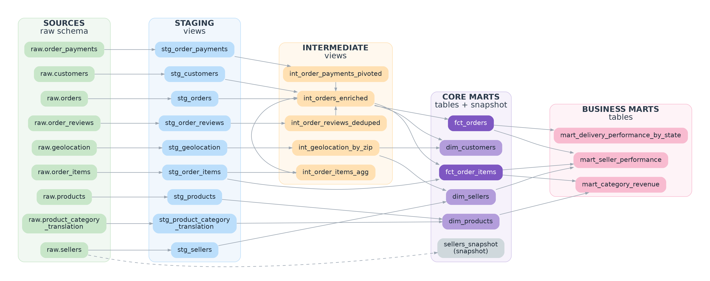

# Olist E-Commerce Analytics with dbt Core and DuckDB

An end-to-end analytics engineering project built with **dbt Core** and **DuckDB** on the public Olist Brazilian e-commerce dataset (about 100k orders across 9 related tables). It turns raw CSV exports into tested, documented, analytics-ready models: staging, intermediate and mart layers, with an incremental fact table, a snapshot, custom macros and a generated docs site.

Every modeling decision is based on exploring the raw data first. The quirks I found are documented in [Data quirks and decisions](#data-quirks-and-decisions).

## Business questions

| # | Question | Answered by |
|---|---|---|
| 1 | Which product categories drive the most revenue? | `mart_category_revenue` |
| 2 | How does late delivery affect review scores? | `fct_orders` |
| 3 | What share of customers are repeat buyers? | `dim_customers` |
| 4 | Which states and sellers have the worst delivery performance? | `mart_delivery_performance_by_state`, `mart_seller_performance` |

## Tech stack
- Python 3.11
- dbt-core 1.12 with the dbt-duckdb adapter
- DuckDB (file-based warehouse, no server or cloud account needed)
- dbt packages: `dbt_utils`

## Project status

| Phase | Scope | Status |
|---|---|---|
| 1 | Repo setup, raw load, sources, 9 staging models | Done |
| 2 | Intermediate models, `fct_orders` (incremental), `dim_customers`, tests | Done |
| 3 | `dim_products`, `dim_sellers`, `fct_order_items`, business marts, snapshot, docs | Done |
| 4 | CI with GitHub Actions, dev vs prod targets, optional cloud warehouse | Upcoming |

---

## Lineage



The diagram shows sources, staging, intermediate and mart layers. Test nodes are left out to keep it readable. The dashed line is the snapshot, which reads straight from the raw sellers table.


</details>

| Layer | Materialization | Purpose |
|---|---|---|
| `raw` (schema) | tables | CSVs loaded exactly as received, every column as text |
| `staging` | views | One model per source table: rename, cast, light cleaning, no joins |
| `intermediate` | views | Deduplication, aggregation and pivoting so every table has one row per key |
| `marts` | tables | Business-ready facts, dimensions and metrics |
| `snapshots` | tables | SCD Type 2 history of seller attributes |

---

## Key findings

All results below come from the delivered orders in the Olist dataset, and revenue is the sum of item prices excluding freight. The dataset reports amounts in Brazilian reais.

### Revenue is concentrated in a few categories
74 categories exist, and the top 10 account for about 62% of delivered revenue.

| Rank | Category | Revenue | Share |
|---|---|---|---|
| 1 | health_beauty | 1,233,132 | 9.33% |
| 2 | watches_gifts | 1,166,177 | 8.82% |
| 3 | bed_bath_table | 1,023,435 | 7.74% |
| 4 | sports_leisure | 954,853 | 7.22% |
| 5 | computers_accessories | 888,725 | 6.72% |

### Delivery performance varies sharply by region
The Northeast has roughly twice the late-delivery rate of the South.

| Region | Delivered orders | Late rate |
|---|---|---|
| Northeast | 9,044 | 14.33% |
| North | 1,796 | 9.80% |
| Central-West | 5,624 | 7.97% |
| Southeast | 66,193 | 7.45% |
| South | 13,813 | 7.05% |

The worst state is Alagoas (AL), with 23.9% of orders late and an average delivery time of 24.5 days. Six of the seven highest late rates are Northeast states. State-level average review scores do not move in lockstep with late rates (for example Tocantins has a 12.8% late rate but a 4.15 average score), so the order-level comparison below is the more reliable way to measure the review impact.

### Seller quality
Among sellers with at least 30 delivered orders, the lowest average review score is 2.39, from a São Paulo seller with 108 orders and a 22% late rate. Sellers with few orders give noisy rates, so rankings use the `orders >= 30` filter.

### Customers and review impact

| Question | Result |
|---|---|
| Share of repeat customers | **2.9%** (2,801 of 96,096 customers have more than one delivered order) |
| Average review score, on-time deliveries | **4.29** (88,644 orders) |
| Average review score, late deliveries | **2.57** (7,826 orders) |

Late delivery is associated with a review score 1.72 points lower, which is a large gap on a 5-point scale. About 8% of delivered orders arrive late. Repeat purchasing is rare (under 3% of customers), so retention is a much bigger opportunity than the raw numbers suggest, and a bad delivery experience is likely to make it harder.

These averages cover delivered orders that have a review. Eight delivered orders have no delivery date, so they fall outside the on-time and late groups.

---

## Dataset

**Brazilian E-Commerce Public Dataset by Olist** on Kaggle (free account required). Check the license on the dataset page before reusing or redistributing anything derived from it.

The raw CSVs are large and are **not committed** to this repo. To reproduce the project, download the dataset, unzip it, and place the 9 files in `olist_analytics/data/raw/`:

```
olist_customers_dataset.csv
olist_geolocation_dataset.csv
olist_order_items_dataset.csv
olist_order_payments_dataset.csv
olist_order_reviews_dataset.csv
olist_orders_dataset.csv
olist_products_dataset.csv
olist_sellers_dataset.csv
product_category_name_translation.csv
```

---

## Repo structure

```
dbt-olist-analytics/
├── README.md
├── .gitignore
├── images/
│   ├── lineage.png
│   └── lineage_dbt_docs.png
└── olist_analytics/                     # the dbt project (run dbt from here)
    ├── dbt_project.yml
    ├── packages.yml
    ├── requirements.txt
    ├── data/
    │   └── raw/                         # 9 Olist CSVs (not committed)
    ├── scripts/
    │   ├── load_raw.py                  # loads CSVs into the DuckDB raw schema
    │   ├── explore.py                   # data profiling (phase 1)
    │   ├── explore2.py                  # deeper profiling for phase 2 decisions
    │   ├── explore3.py                  # product category translation coverage
    │   ├── check_phase2.py              # row counts and first insights
    │   ├── check_phase3.py              # mart results and findings
    │   ├── incremental_demo.py          # simulates new data for the incremental model
    │   └── simulate_seller_change.py    # simulates a change for the snapshot
    ├── macros/
    │   ├── days_between.sql
    │   └── state_to_region.sql
    ├── models/
    │   ├── docs.md                      # doc blocks
    │   ├── staging/
    │   │   ├── sources.yml
    │   │   ├── schema.yml
    │   │   └── stg_*.sql                # 9 models
    │   ├── intermediate/
    │   │   ├── schema.yml
    │   │   └── int_*.sql                # 5 models
    │   └── marts/
    │       ├── schema.yml
    │       ├── fct_orders.sql
    │       ├── fct_order_items.sql
    │       ├── dim_customers.sql
    │       ├── dim_products.sql
    │       ├── dim_sellers.sql
    │       ├── mart_category_revenue.sql
    │       ├── mart_delivery_performance_by_state.sql
    │       └── mart_seller_performance.sql
    ├── snapshots/
    │   └── sellers_snapshot.yml
    ├── seeds/
    └── tests/                           # 6 singular tests
```

Not committed (see `.gitignore`): `target/`, `logs/`, `dbt_packages/`, `*.duckdb`, `venv/`, `profiles.yml`, `data/raw/`.

---

## Setup

### 1. Clone and create a virtual environment

```bash
git clone <your-repo-url>
cd dbt-olist-analytics/olist_analytics

python -m venv venv

# Windows
venv\Scripts\activate
# Mac/Linux
source venv/bin/activate
```

### 2. Install dependencies

```bash
pip install -r requirements.txt
dbt --version
```

`requirements.txt`:
```
dbt-core
dbt-duckdb
```

### 3. Add the dbt profile (not committed)

Add this block to `~/.dbt/profiles.yml` (Windows: `C:\Users\<you>\.dbt\profiles.yml`). Keep any existing profiles in the file.

```yaml
olist_analytics:
  target: dev
  outputs:
    dev:
      type: duckdb
      path: dev.duckdb
      threads: 4
    prod:
      type: duckdb
      path: prod.duckdb
      threads: 8
```

### 4. Load the raw data and build

Run everything from the `olist_analytics/` folder, so `path: dev.duckdb` points at the same database file the load script writes to.

```bash
python scripts/load_raw.py       # raw CSVs -> dev.duckdb (schema: raw)
dbt deps                         # install dbt_utils
dbt debug                        # expect "All checks passed"
dbt build                        # run, test and snapshot in DAG order
```

> DuckDB allows only one writer at a time. Close any script or shell that has `dev.duckdb` open before running dbt.

### 5. Explore the results

```bash
python scripts/check_phase3.py
dbt docs generate
dbt docs serve --port 8081
```

---

## Phase 1: Setup, raw data, sources and staging

### Raw loading
`scripts/load_raw.py` loads each CSV into the `raw` schema with `all_varchar = true`. Raw data is kept exactly as received, with no type guessing. This matters here because zip code prefixes such as `01046` would lose their leading zero if DuckDB guessed an integer. Types are applied in the staging layer.

```python
con.execute(
    "CREATE OR REPLACE TABLE raw.orders AS "
    "SELECT * FROM read_csv(?, header = true, all_varchar = true)",
    [str(csv_path)],
)
```

The script builds paths from `__file__`, so it works from any working directory, and it accepts an optional database path for loading into `prod.duckdb`:

```bash
python scripts/load_raw.py prod.duckdb
```

### Sources
All 9 raw tables are declared in `models/staging/sources.yml` and referenced with `source('olist', '<table>')`. Primary-key tests (`unique`, `not_null`) run on customers, orders, products and sellers. Freshness checks are deliberately omitted: this is a static dataset with no load timestamp, so a freshness rule would be meaningless.

### Staging models

One model per source table, with renames, type casts and light cleaning only.

| Model | Grain | Notes |
|---|---|---|
| `stg_customers` | one row per `customer_id` | City lowercased, state uppercased |
| `stg_orders` | one row per order | All timestamps cast to `timestamp` |
| `stg_order_items` | one row per order item | `price` and `freight_value` cast to `decimal(10,2)` |
| `stg_order_payments` | one row per payment | An order can have several |
| `stg_order_reviews` | one row per review | `review_id` is not unique (see quirks) |
| `stg_products` | one row per product | Fixes the `lenght` typo in the raw column names |
| `stg_sellers` | one row per seller | |
| `stg_geolocation` | one row per coordinate point | About 52 points per zip prefix |
| `stg_product_category_translation` | one row per category | Portuguese to English names |

**Phase 1 result:** 9 staging views built and 8 source tests passed.

---

## Data quirks and decisions

| Finding | Decision |
|---|---|
| 99,441 `customer_id`s but only 96,096 unique people | `customer_id` is per order. `dim_customers` is keyed on `customer_unique_id`. |
| 789 `review_id`s are shared across different orders, and 547 orders have more than one review | `review_id` is not a key. Keep one review per order, the latest. |
| 1,000,163 geolocation rows for 19,015 zip prefixes | Aggregate to one row per zip before joining, otherwise rows multiply about 52 times. |
| 775 orders have no items: 603 unavailable, 164 canceled, 5 created, 2 invoiced, 1 shipped | None are `delivered`. Use a left join and set `item_count = 0`. |
| 2,961 orders have more than one payment row | Pivot payments to one row per order with a Jinja loop. |
| 8 delivered orders have no delivery date | Singular test with `severity: warn`, so the quirk is documented without blocking the build. |
| 97% of orders are `delivered`, with 7 other statuses | `accepted_values` test lists all 8 statuses, and business metrics use delivered orders only. |
| Some products have no category or no English translation | `coalesce` to the Portuguese name, then `unknown`. |

---

## Phase 2: Intermediate models, marts and tests

### Intermediate models

| Model | Grain | What it does |
|---|---|---|
| `int_order_reviews_deduped` | one row per order | Ranks reviews per order with `row_number()` and keeps the latest |
| `int_geolocation_by_zip` | one row per zip prefix | Average latitude and longitude, most common state |
| `int_order_payments_pivoted` | one row per order | Payment totals and one value column per payment type, generated by a Jinja `for` loop |
| `int_order_items_agg` | one row per order | Item count, seller count, items value, freight value |
| `int_orders_enriched` | one row per order | Joins orders, customers, items, payments and reviews, and adds delivery metrics |

Each table joined into `int_orders_enriched` has exactly one row per `order_id`, so the join cannot multiply rows. A singular test enforces this.

**Jinja loop for the payment pivot:**
```sql


select
    order_id,
    sum(payment_value) as total_payment_value,
    
    sum(case when payment_type = '{{ p }}' then payment_value else 0 end) as {{ p }}_value
    ,
    
from {{ ref('stg_order_payments') }}
group by order_id
```
The `accepted_values` test on `payment_type` fails if a new type appears that the list does not cover.

### Marts

**`fct_orders`** is one row per order with value, payment, review and delivery metrics. It is an **incremental** model with a lookback window:

```sql
{{ config(materialized='incremental', unique_key='order_id') }}

select *
from {{ ref('int_orders_enriched') }}


where purchased_at >= (select max(purchased_at) from {{ this }})
                      - interval '{{ var("orders_lookback_days", 30) }} days'

```

Why a lookback window instead of a plain `>` filter: an order's status and delivery date change after purchase, so a plain filter would never refresh recent orders. The overlapping rows are updated in place thanks to `unique_key`. The window is set by the `orders_lookback_days` variable in `dbt_project.yml`.

**`dim_customers`** is one row per real customer (`customer_unique_id`) with order history, lifetime value and latest location. Two design decisions:
- A customer's location comes from their **latest** order.
- A **repeat customer** has more than one **delivered** order, so canceled orders do not count.

**Phase 2 row counts:**

| Model | Rows |
|---|---|
| `stg_orders`, `int_orders_enriched`, `fct_orders` | 99,441 |
| `dim_customers` | 96,096 |
| `int_geolocation_by_zip` | 19,015 |

---

## Phase 3: Dimensions, business marts and snapshot

| Model | Grain | Rows | Purpose |
|---|---|---|---|
| `dim_products` | one row per product | 32,951 | Product attributes with English category names (fallback: Portuguese name, then `unknown`) |
| `dim_sellers` | one row per seller | 3,095 | Location, region and coordinates |
| `fct_order_items` | one row per order item | 112,650 | Item price, freight and a surrogate key built from `order_id` and `order_item_id` |
| `mart_category_revenue` | one row per category | 74 | Revenue, share and rank (delivered orders only) |
| `mart_delivery_performance_by_state` | one row per state | 27 | Delivery days, late rate, review score |
| `mart_seller_performance` | one row per seller | 2,970 | Revenue, late rate, review score |

- `fct_order_items` has the same row count as `stg_order_items` (112,650), and a singular test enforces that no items are dropped by the join to orders.
- `mart_seller_performance` has fewer rows than `dim_sellers` because it only includes sellers with at least one delivered order.
- It first groups by seller and order, so an order with several items from one seller is counted once.
- **Revenue definition:** item price excluding freight, on delivered orders only. It is documented with a doc block and shown in the docs site.

### Macros

| Macro | Purpose |
|---|---|
| `days_between(start_ts, end_ts)` | Calendar days between two timestamps |
| `state_to_region(state_col)` | Maps Brazilian states to the five official regions. States it doesn't recognize become `Unknown`, which fails the `accepted_values` test on `region` |

### Snapshot

`sellers_snapshot` is an SCD Type 2 snapshot of the raw sellers table (`check` strategy on zip code, city and state). It reads from the raw source rather than a staging model, so it captures source changes before any transformation.

Olist is a static dataset, so a change is simulated with `scripts/simulate_seller_change.py`. Result of the demo:

| seller_id | seller_city | dbt_valid_from | dbt_valid_to |
|---|---|---|---|
| 0015a82c2db000af6aaaf3ae2ecb0532 | santo andre | 2026-11-02 13:24:55 | 2026-11-02 13:26:28 |
| 0015a82c2db000af6aaaf3ae2ecb0532 | demo city | 2026-11-02 13:26:28 | NULL |

The old version is closed with a `dbt_valid_to` timestamp, and the current version has `NULL`.

---

## Testing

| Type | Examples |
|---|---|
| Source tests | `unique` and `not_null` on raw primary keys |
| Staging tests | `accepted_values` on `order_status`, `payment_type` and `review_score`; `relationships` from orders and items to their parents; `unique_combination_of_columns` on `(order_id, order_item_id)` |
| Intermediate tests | `unique` and `not_null` on every grain key |
| Mart tests | `unique` and `not_null` on every primary key; `relationships` between facts and dimensions; `accepted_values` on `region`; `accepted_range` on review score, payment value and late rate |
| Singular tests | Delivered date is not before purchase date; delivered orders have a delivery date (warn); enriched row count equals order count; fact item count equals staging item count; item prices add up between `fct_order_items` and `fct_orders`; payments cover items plus freight (warn) |

Test arguments use the `arguments:` syntax required by dbt 1.12:
```yaml
- accepted_values:
    arguments:
      values: ['created', 'approved', 'invoiced', 'processing', 'shipped', 'delivered', 'unavailable', 'canceled']
```

**Known warnings (by design):**
- 8 delivered orders have no delivery date (source data quirk).
- _N_ delivered orders have a payment total that differs from items plus freight by more than 1 (vouchers and installment interest can explain differences). Fill in `N` from your `dbt build` output.

---

## Command cheat sheet

| Command | Purpose |
|---|---|
| `python scripts/load_raw.py` | Load raw CSVs into DuckDB |
| `dbt deps` | Install packages |
| `dbt debug` | Verify connection and config |
| `dbt build` | Run, test and snapshot in DAG order |
| `dbt snapshot` | Capture seller history |
| `dbt run --select fct_orders` | Build one model (incremental after the first run) |
| `dbt run --select fct_orders --full-refresh` | Rebuild the incremental model from scratch |
| `dbt test --select source:olist` | Test the raw sources |
| `dbt build --select +mart_seller_performance` | A model and everything upstream |
| `dbt docs generate` / `dbt docs serve --port 8081` | Documentation and lineage graph |

---

## Troubleshooting

| Problem | Cause and fix |
|---|---|
| `Could not find profile named olist_analytics` | The profile block is missing from `profiles.yml`, or the name differs |
| `Catalog Error: Table ... does not exist` in a script | The script opened a different `dev.duckdb`. Build the path from `__file__` or run from `olist_analytics/` |
| `Database is locked` | Another script or shell has the `.duckdb` file open |
| `fetchone()` error on `con.sql(...)` | Newer DuckDB removed it. Use `con.execute(...).fetchone()` |
| Staging fails with `column not found` | Check the real header with `describe raw.<table>` |
| `dbt_utils` not found | Run `dbt deps` from the folder containing `packages.yml` |
| `accepted_values` fails on `payment_type` | A new type exists. Add it to the test and to the Jinja loop |
| `accepted_values` fails on `region` | The macro returned `Unknown`. Check `select distinct state from dim_sellers` |
| Row count test fails | A joined model has duplicate keys. Check which `unique` test failed upstream |
| Snapshot schema not found | With default naming it lands in `main_snapshots`. Run `show all tables` |
| Folder-level configs ignored | The key under `models:` must match `name:` in `dbt_project.yml` |

---

## Roadmap

- **Phase 4:** GitHub Actions CI running `dbt build` on pull requests, dev vs prod targets, optional re-run on a cloud warehouse

## Learning journey
This project builds on a 4-week dbt Core learning repo covering setup, sources and staging, testing and documentation, and incremental models, snapshots, macros and packages.